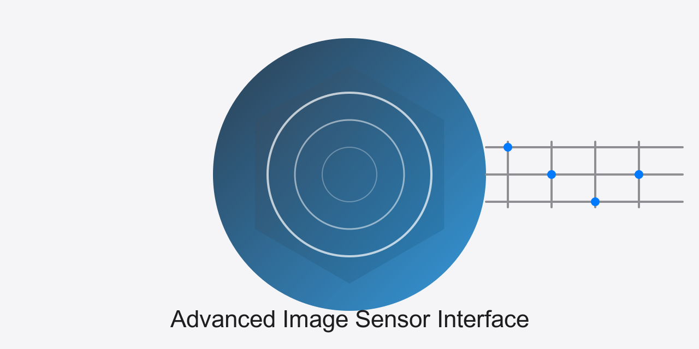
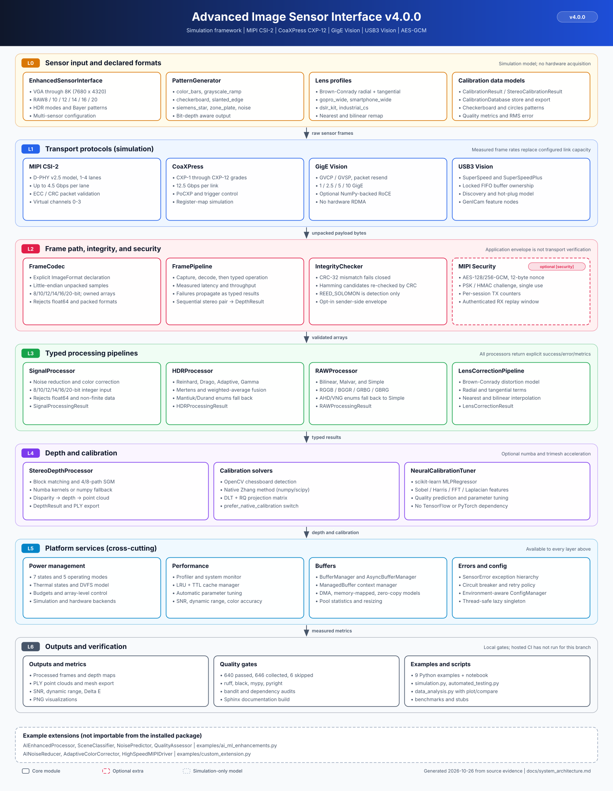

<div align="center">

# Advanced Image Sensor Interface



[](https://www.python.org/)


[](https://github.com/muditbhargava66/Advanced-Image-Sensor-Interface/actions/workflows/github-code-scanning/codeql)
[](https://github.com/muditbhargava66/Advanced-Image-Sensor-Interface/actions/workflows/ci.yml)

[](https://github.com/psf/black)
[](https://github.com/astral-sh/ruff)
[](https://github.com/microsoft/pyright)
[](https://docs.pytest.org/)
[](https://advanced-image-sensor-interface.readthedocs.io/en/latest/?badge=latest)


</div>

## Overview

The Advanced Image Sensor Interface is a Python simulation framework for multi-protocol camera interfaces (MIPI CSI-2, CoaXPress, GigE Vision, and USB3 Vision), with image processing, multi-sensor synchronization, and camera calibration. Version 4.0.0 adds real AES-GCM authenticated encryption through the optional `[security]` extra, an explicit `FrameCodec`/`FramePipeline` capture-to-processing path with unpacked 8/10/12/14/16/20-bit frame storage, fail-closed integrity verification, measured protocol lifecycle metrics, stricter processing format validation, and security-focused dependency and CI remediation.

### New in Version 4.0.0

- **Real AES-GCM Security**: Optional `[security]` extra (`cryptography`) implements AES-128/256-GCM with 12-byte nonces, 16-byte tags, guarded imports, and fail-closed encryption requests; AES-CBC rejected; identity-bound single-use expiring challenges; per-session TX counters and authenticated RX replay windows; credentials excluded from `repr`
- **Explicit Frame Pipeline**: `FrameCodec` and `FramePipeline` validate declared formats, decode little-endian unpacked frames into owned arrays, measure capture latency and throughput, and hand samples to typed signal/RAW/stereo processing without hiding failures
- **Integrity Fail-Closed**: CRC mismatches are never reported valid; Hamming corrections are re-checked against the original trailer; the legacy Reed-Solomon mode is documented as checksum detection, not correction
- **Protocol Lifecycle Contracts**: Unpacked frame storage and format validation across MIPI, GigE/RoCE, CoaXPress, and USB3; unknown and bit-packed formats raise; measured traffic and frame rates replace configured link capacity; stop/disconnect failures stay visible; USB3 buffers use locked FIFO ownership with copy-on-read frames
- **Processing Format Repair**: 20-bit uint32 support, RAW20 stored as uint32, typed RAW failures without fallback images, explicit rejection of float64 and non-finite frames, and depth PLY export failure propagation
- **Security Remediation**: Pillow 13.0.0 floor plus virtualenv, filelock, certifi, urllib3, tornado, nbconvert, Werkzeug, setuptools, black, soupsieve 3.0.2, and msgpack 1.2.3 floors; SHA-pinned GitHub Actions (setup-uv v10.3.3); profile-based dependency audits; docs built on pull requests
- **640 Tests Passing**: 646 collected; 640 passed, 6 skipped with OpenCV and without numba/trimesh

### What This Is / Isn't

**What This Is:**
- High-level Python simulation framework for image sensor interfaces
- MIPI CSI-2 protocol modeling and validation tools
- Image processing algorithm development and testing platform
- Power management simulation and modeling
- Algorithm prototyping and benchmarking framework
- Educational tool for understanding sensor interfaces

**Use it for:** validating protocol frame formats and lifecycles, prototyping signal/HDR/RAW/stereo-depth algorithms, testing calibration and multi-sensor synchronization, benchmarking on CPU (CUDA optional), and teaching sensor-interface concepts.

**What This Is NOT:**
- Hardware PHY or kernel driver implementation
- Real-time image processing system (not optimized for 8K@120fps)
- Firmware or embedded system code
- Hardware abstraction layer (HAL)
- Production camera driver

**Performance Note:** All throughput numbers are simulation targets in Python, not hardware measurements. Real hardware performance would differ significantly.

## System Overview



The diagram shows the current module boundaries and data flow. The accompanying
[System Architecture](docs/system_architecture.md) document records the layer
responsibilities, frame-storage contract, integrity and security semantics, and
the source files behind each claim. The SVG is generated by
`scripts/generate_architecture_diagram.py`; a 2x PNG is available at
`assets/system-architecture-v4.0.0.png`.

## Key Features

### Core Features (v1.x)
- **MIPI CSI-2 Protocol Simulation**: Complete packet-level simulation with ECC/CRC validation
- **Signal Processing**: Noise reduction and image enhancement algorithms
- **Power Management Modeling**: Simulates power delivery and noise characteristics
- **Multi-Protocol Support**: MIPI CSI-2, GigE Vision, and CoaXPress protocol models
- **Image Validation**: Bit-depth safety and format validation across 8-20 bit depths
- **Automated Calibration**: Neural network and parametric calibration tuning
- **Flexible Architecture**: Modular design for easy customization and extension
- **Test Suite**: 640 automated tests across core, protocol, and integration flows
- **Type Checking Support**: MyPy and Pyright are configured for maintained source modules

### New Features (v2.0.0)
- **Enhanced Sensor Interface**: Support for resolutions up to 8K (7680x4320) with timing controls
- **HDR Image Processing**: Multiple tone mapping algorithms (Reinhard, Drago, Adaptive) with exposure fusion
- **RAW Image Processing**: Complete RAW pipeline with Bayer demosaicing, white balance, and color correction
- **Multi-Sensor Synchronization**: Hardware and software synchronization for stereo and multi-camera setups
- **GPU Acceleration**: CUDA (CuPy/Numba) with automatic CPU fallback; OpenCL is enumerated but unimplemented and Apple MPS is not yet supported (Apple Silicon runs on CPU)
- **Advanced Power Management**: Dynamic power states, thermal monitoring, and battery management
- **Application-Specific Optimizations**: Pre-configured settings for automotive, surveillance, and mobile applications
- **Real-World Scenario Testing**: Test patterns and validation for production environments

### Retained Features (v3.0.0–v3.3.0)

- **v3.3.0 — Dependency maintenance**: widened optional-dependency ceilings (opencv-python, pandas, astropy, trimesh, pyzmq) and docs/CI tooling; no API changes
- **v3.2.0 — Typed results & 3D**: typed `SignalProcessingResult`/`HDRProcessingResult`/`RAWProcessingResult`/`LensCorrectionResult`; `SimulationDelayConfig`; `StereoDepthProcessor` (Block Matching + 8-path SGM, PLY/mesh export); native numpy/scipy calibration (`calibrate_camera`, `solve_projection_matrix`); Python 3.11+
- **v3.1.0 — AI/ML & sync**: Neural Calibration Tuner and noise-reduction framework (package modules); example-only `SceneClassifier`/`NoisePredictor`/`QualityAssessor`/`AINoiseReducer`/`AdaptiveColorCorrector`; ORB+RANSAC and phase-correlation multi-sensor alignment; PRE_SHARED_KEY auth
- **v3.0.0 — Protocols & imaging**: CoaXPress CXP-12 (50 Gbps), GigE Vision RoCE simulation, MIPI D-PHY v2.5, USB3 streaming/discovery, CRC-32 fail-closed integrity, lens correction, multi-system power budgeting

### Simulation Targets (Not Hardware Measurements)

These are **algorithmic/theoretical targets** for the simulation framework, not measured performance:

- **MIPI Lane Rate**: Up to 4.5 Gbps per lane; 18 Gbps aggregate model with 4 lanes
- **Processing Speed**: Simulated targets of 120 fps at 4K and 30 fps at 8K; actual results depend on CPU and input
- **Power Efficiency**: <500 mW at 4K/60fps, <2W at 8K/30fps (modeled)
- **SNR Improvement**: Computed per run by `utils/performance_metrics.py`; results depend on input and algorithm
- **HDR Processing**: Multiple implemented tone-mapping and fusion operators; dynamic range depends on input
- **Multi-Sensor Sync Accuracy**: Modeled timing tolerance, measured in Python simulation

## Technical Specifications

### Core Specifications
- **MIPI CSI-2 Compatibility**: D-PHY v2.5 model with 1-4 data lanes and up to 4.5 Gbps per lane
- **Image Processing**: 8-20 bit depth with support for resolutions up to 8K (7680x4320)
- **Noise Reduction**: Exposes a measured SNR change per run; no fixed improvement is guaranteed
- **Color Accuracy**: Computes mean Delta E per run against reference colors
- **Power Efficiency**: < 500 mW at 4K/60fps, < 2W at 8K/30fps (modeled)

### v2.0.0 Enhanced Specifications
- **Resolution Support**: VGA to 8K (7680x4320) with custom resolution support
- **HDR Processing**: 14+ stops dynamic range with multiple tone mapping algorithms
- **RAW Formats**: Support for 8-20 bit RAW with RGGB, BGGR, GRBG, GBRG Bayer patterns
- **Multi-Sensor**: Up to 8 synchronized sensors with ~1ms timing accuracy (measured in simulation)
- **GPU Acceleration**: CUDA (CuPy/Numba) with CPU fallback; OpenCL stub, no Apple MPS backend yet
- **Power States**: 7 power states from active to hibernate with thermal monitoring
- **Frame Rates**: Simulated frame rates depend on resolution, algorithm, and CPU; benchmark values vary per machine

## Project Structure

```
advanced_image_sensor_interface/
├── src/advanced_image_sensor_interface/
│   ├── __init__.py                     # Public exports
│   ├── _version.py
│   ├── types.py                        # Typed results, configs, interfaces
│   ├── config/constants.py             # ConfigManager and limits
│   ├── error_handling/                 # Exceptions, circuit breaker, retry, recovery
│   ├── performance/                    # Profiler, monitor, cache, optimizer
│   ├── test_patterns/pattern_generator.py
│   ├── sensor_interface/
│   │   ├── pipeline.py                 # v4.0.0: FrameCodec, FramePipeline
│   │   ├── enhanced_sensor.py
│   │   ├── hdr_processing.py
│   │   ├── raw_processing.py
│   │   ├── signal_processing.py
│   │   ├── image_validation.py
│   │   ├── multi_sensor_sync.py
│   │   ├── gpu_acceleration.py
│   │   ├── advanced_processing.py
│   │   ├── advanced_power_management.py
│   │   ├── power_backends.py
│   │   ├── buffer_management.py
│   │   ├── security.py                 # Input and buffer validation
│   │   ├── mipi_protocol.py
│   │   ├── mipi_driver.py              # Legacy MIPI compatibility
│   │   ├── power_management.py         # Legacy power compatibility
│   │   ├── protocol_selector.py
│   │   ├── calibration/
│   │   │   ├── models.py
│   │   │   ├── photogrammetry.py       # Native numpy/scipy solver
│   │   │   └── neural_tuner.py
│   │   └── protocol/
│   │       ├── base.py
│   │       ├── mipi/                   # driver.py, security.py, v4_1.py
│   │       ├── coaxpress/              # driver.py, cxp12.py
│   │       ├── gige/                   # driver.py, roce.py
│   │       └── usb3/                   # driver.py, streaming.py, discovery.py
│   └── utils/
│       ├── buffer_manager.py
│       ├── data_integrity.py
│       ├── depth.py                    # Block matching, 4/8-path SGM, PLY
│       ├── lens_correction.py
│       ├── noise_reduction.py
│       └── performance_metrics.py
├── examples/                           # 9 Python examples + interactive_demo.ipynb
│   ├── ai_ml_enhancements.py           # Example-only AI/ML pipeline
│   ├── custom_extension.py             # Example-only custom extensions
│   ├── stereo_depth_example.py
│   └── native_calibration_example.py
├── scripts/
│   ├── simulation.py
│   ├── automated_testing.py
│   ├── data_analysis.py
│   └── generate_architecture_diagram.py
├── benchmarks/                         # Buffer, depth, noise, speed, performance
├── stubs/                              # cupy, skimage, smbus
├── assets/
│   ├── README.md
│   ├── system-architecture-v4.0.0.svg
│   ├── system-architecture-v4.0.0.png
│   └── historical diagrams
├── docs/
│   ├── system_architecture.md          # v4.0.0 architecture and evidence index
│   ├── design_specs.md
│   ├── performance_analysis.md
│   ├── api_documentation.md
│   ├── testing_guide.md
│   └── protocol_*.md, calibration.md, hardware_integration.md
├── tests/                              # 646 collected tests
│   ├── test_capture_pipeline.py        # v4.0.0: frame codec and pipeline
│   ├── test_integrity_contracts.py     # v4.0.0: integrity semantics
│   ├── test_mipi_security.py           # v4.0.0: AES-GCM and replay windows
│   ├── test_processing_contracts.py    # v4.0.0: typed processing formats
│   ├── test_protocol_contracts.py      # v4.0.0: frame and lifecycle contracts
│   ├── test_depth_module.py
│   ├── test_calibration_solver.py
│   └── ...                             # protocol, imaging, power, buffer tests
├── README.md
├── CHANGELOG.md
├── CONTRIBUTING.md
├── requirements.txt
├── pyproject.toml
├── tox.ini
├── mypy.ini
└── .gitignore
```

## Installation

### Quick Start with uv (Recommended)

[uv](https://docs.astral.sh/uv/) is a fast Python package installer and resolver. It's the recommended way to install this project.

```bash
# Clone the repository
git clone https://github.com/muditbhargava66/Advanced-Image-Sensor-Interface.git
cd Advanced-Image-Sensor-Interface

# Install the package with all dependency groups and optional extras
uv sync --all-groups --all-extras

# Or install specific dependency groups (tooling):
uv sync --group dev      # Development dependencies (pytest, ruff, mypy, black)
uv sync --group docs     # Documentation dependencies (sphinx, myst-parser)

# Or install specific optional extras (features):
uv sync --extra security     # Real AES-GCM backend (cryptography)
uv sync --extra full         # Full optional feature set (opencv, scikit-image, etc.)
uv sync --extra performance  # Performance profiling tools
```

### Traditional pip Installation

If you prefer pip, you can still use the traditional method:

1. Clone the repository:
   ```
   git clone https://github.com/muditbhargava66/Advanced-Image-Sensor-Interface.git
   cd advanced_image_sensor_interface
   ```

2. Set up a virtual environment (optional but recommended):
   ```
   python -m venv venv
   source venv/bin/activate  # On Windows, use `venv\Scripts\activate`
   ```

3. Install core dependencies:
   ```bash
   pip install -r requirements.txt
   ```

4. Install the package in editable mode:
   ```bash
   pip install -e .
   ```

5. For development, full features, or documentation dependencies:
   ```bash
   # Full optional feature set (opencv, scikit-image, requests, etc.)
   pip install -e ".[full]"

   # Real AES-GCM MIPI security backend (cryptography)
   pip install -e ".[security]"

   # Development and test dependencies (pytest, ruff, mypy, black)
   pip install -e ".[dev]"

   # Documentation dependencies (sphinx, myst-parser)
   pip install -e ".[docs]"
   ```

6. **Optional: Install GPU acceleration dependencies**
   ```bash
   # For CUDA support (NVIDIA GPUs)
   pip install cupy-cuda12x  # Replace 12x with your CUDA version
   
   # For JIT acceleration
   pip install numba
   ```

7. Verify installation:
   ```python
   # Test legacy v1.x features
   from advanced_image_sensor_interface import MIPIDriver, MIPIConfig
   print("v1.x features available!")
   
   # Test v2.0.0 features
   try:
       from advanced_image_sensor_interface import EnhancedSensorInterface
       print("v2.0.0 features available!")
   except ImportError:
       print("v2.0.0 features require additional dependencies")
   ```

## Usage

### v4.0.0 Frame Capture and Processing

`FrameCodec` serializes an explicitly declared integer format (little-endian,
unpacked) and `FramePipeline` captures through the selected streaming driver,
decodes to an owned array, and hands samples to a typed operation while recording
measured latency and throughput.

```python
import numpy as np
from advanced_image_sensor_interface import FrameCodec, FramePipeline
from advanced_image_sensor_interface.sensor_interface.image_validation import ImageFormat, SupportedDType
from advanced_image_sensor_interface.sensor_interface.protocol_selector import ProtocolSelector, ProtocolType
from advanced_image_sensor_interface.sensor_interface.protocol.mipi import MIPIConfig, MIPIProtocolDriver
from advanced_image_sensor_interface.sensor_interface.signal_processing import SignalConfig, SignalProcessor

# Declare the wire format: 160x120, 1 channel, 12-bit unpacked uint16
fmt = ImageFormat(120, 160, 1, 12, SupportedDType.UINT16)
driver = MIPIProtocolDriver(MIPIConfig(lanes=4, data_rate_mbps=2500.0, pixel_format="RAW12", resolution=(160, 120)))

selector = ProtocolSelector()
selector.register_protocol(ProtocolType.MIPI, driver, {})
selector.activate_protocol(ProtocolType.MIPI)
driver.connect()
driver.start_streaming()

pipeline = FramePipeline(selector, FrameCodec(fmt))
frame = pipeline.capture_frame()  # decoded, owned uint16 array

processor = SignalProcessor(SignalConfig(bit_depth=12, noise_reduction_strength=0.1, color_correction_matrix=np.eye(3)))
result = pipeline.process_frame(processor.process_frame)  # typed SignalProcessingResult
print(result.success, frame.shape)

driver.stop_streaming()
driver.disconnect()

# FrameCodec round-trip (optionally pass an IntegrityChecker to protect/verify)
codec = FrameCodec(fmt)
decoded = codec.decode(codec.encode(frame))
assert np.array_equal(decoded, frame)
```

### Legacy Usage (v1.x - Backward Compatible)

```python
from advanced_image_sensor_interface import MIPIDriver, MIPIConfig
from advanced_image_sensor_interface import SignalProcessor, SignalConfig  
from advanced_image_sensor_interface import PowerManager, PowerConfig
import numpy as np

# Define image parameters
width, height, channels = 1920, 1080, 3
bit_depth = 12
max_value = (2 ** bit_depth) - 1

# Calculate frame size in bytes (for MIPI simulation)
frame_size = width * height * channels * 2  # 2 bytes per pixel for 12-bit

# Initialize simulation components
mipi_config = MIPIConfig(lanes=4, data_rate=2.5, channel=0)
mipi_driver = MIPIDriver(mipi_config)

signal_config = SignalConfig(
    bit_depth=bit_depth, 
    noise_reduction_strength=0.1,
    color_correction_matrix=np.eye(3)
)
signal_processor = SignalProcessor(signal_config)

power_config = PowerConfig(voltage_main=1.8, voltage_io=3.3, current_limit=1.0)
power_manager = PowerManager(power_config)

# Generate test frame with proper format
test_frame = np.random.randint(0, max_value + 1, (height, width, channels), dtype=np.uint16)
print(f"Generated test frame: {test_frame.shape}, dtype: {test_frame.dtype}")
print(f"Value range: {test_frame.min()} - {test_frame.max()}")

# Simulate MIPI data transfer
frame_bytes = test_frame.tobytes()
mipi_success = mipi_driver.send_data(frame_bytes)
print(f"MIPI transfer: {'Success' if mipi_success else 'Failed'}")

# Process frame through simulation
# v3.2.0: process_frame returns a typed SignalProcessingResult
result = signal_processor.process_frame(test_frame)
if result.success:
    processed_frame = result.data
    print(f"Processed frame shape: {processed_frame.shape}")
    print(f"SNR improvement: {result.snr_improvement_db:.2f} dB")
else:
    print(f"Processing failed: {result.error}")

# Get power status
power_status = power_manager.get_power_status()
print(f"Simulated power consumption: {power_status['power_consumption']:.3f} W")
print(f"Temperature: {power_status['temperature']:.1f} °C")

# Get MIPI status
mipi_status = mipi_driver.get_status()
print(f"MIPI throughput: {mipi_status['throughput']:.2f} Gbps (simulated)")
```

### MIPI Protocol Validation

```python
from advanced_image_sensor_interface.sensor_interface.mipi_protocol import (
    ShortPacket, LongPacket, DataType, MIPIProtocolValidator
)

# Create and validate MIPI packets
frame_start = ShortPacket(
    virtual_channel=0,
    data_type=DataType.FRAME_START,
    data=0x0000
)

validator = MIPIProtocolValidator()
packet_bytes = frame_start.to_bytes()
is_valid = validator.validate_packet(packet_bytes)
print(f"Packet valid: {is_valid}")
```

### New v3.0.0 Protocol Examples

#### CoaXPress CXP-12 (50Gbps)

```python
from advanced_image_sensor_interface.sensor_interface.protocol.coaxpress import (
    CXP12Config, CXP12Driver, CXPSpeed
)

# Configure CXP-12 with 4 lanes at 12.5Gbps each
config = CXP12Config(speed=CXPSpeed.CXP_12, lanes=4)
print(f"Aggregate bandwidth: {config.aggregate_bandwidth_gbps}Gbps")  # 50.0

driver = CXP12Driver(config)
driver.connect()
driver.start_streaming()
frame = driver.capture_frame()  # 16-bit frame data
driver.stop_streaming()
driver.disconnect()
```

#### GigE Vision RoCE Transport

```python
from advanced_image_sensor_interface.sensor_interface.protocol.gige import (
    RoCETransport, RoCEConfig, RoCEVersion
)

# Configure RDMA over Converged Ethernet
config = RoCEConfig(version=RoCEVersion.ROCE_V2, mtu=4096)
transport = RoCETransport()
transport.initialize()

# Create queue pair for zero-copy transfers
qp_num = transport.create_queue_pair()
transport.connect_qp(qp_num, remote_qp=1, remote_gid=bytes(16))
transport.send(qp_num, frame_data)

stats = transport.get_statistics()
print(f"Bytes sent: {stats.bytes_sent}")
```

#### MIPI D-PHY v2.5 (4.5Gbps)

```python
from advanced_image_sensor_interface.sensor_interface.protocol.mipi import (
    DPHY25Config, DPHY25Driver, EqualizationMode
)

# Configure D-PHY v2.5 with adaptive equalization
config = DPHY25Config(
    lanes=4,
    data_rate_gbps=4.5,
    equalization=EqualizationMode.ADAPTIVE
)
print(f"Aggregate bandwidth: {config.aggregate_bandwidth_gbps}Gbps")  # 18.0

driver = DPHY25Driver(config)
driver.connect()
driver.start_streaming()
stats = driver.get_statistics()
print(f"Packets sent: {stats.packets_sent}")
```

#### MIPI Security Framework

```python
import hashlib
import hmac

from advanced_image_sensor_interface.sensor_interface.protocol.mipi import (
    AuthenticationMethod,
    EncryptionAlgorithm,
    MIPISecurityManager,
    PrivilegeLevel,
    SecurityConfig,
    SecurityCredentials,
)

# AES-GCM requires the optional security extra: pip install ".[security]"
config = SecurityConfig(
    authentication=AuthenticationMethod.PRE_SHARED_KEY,
    encryption=EncryptionAlgorithm.AES_128_GCM,
)
manager = MIPISecurityManager(config)

psk = b"0123456789abcdef0123456789abcdef"
credentials = SecurityCredentials(
    identity="camera_01",
    privilege_level=PrivilegeLevel.ADMIN,
    pre_shared_key=psk,
)
manager.register_identity(credentials)

# The manager issues a single-use challenge; the client proves possession of the PSK
challenge = manager.authenticator.generate_challenge("camera_01")
proof = hmac.new(psk, challenge, hashlib.sha256).digest()
session = manager.create_session("camera_01", proof, challenge)
if session is None:
    raise RuntimeError("authentication failed")
print(f"Session ID: {session.session_id}")
```

#### USB3 Enhanced Streaming

```python
from advanced_image_sensor_interface.sensor_interface.protocol.usb3 import (
    USB3StreamingManager, StreamConfig
)

config = StreamConfig(buffer_count=10, timeout_ms=5000)
manager = USB3StreamingManager(config)

manager.prepare(width=1920, height=1080, pixel_format="Mono8")
manager.start_streaming()

frame_data, frame_info = manager.get_frame()
print(f"Frame {frame_info.frame_id}: {len(frame_data)} bytes")

stats = manager.get_statistics()
print(f"Frames captured: {stats.frames_captured}")
```

#### Data Integrity (CRC and Redundancy)

```python
from advanced_image_sensor_interface.utils.data_integrity import (
    CRCValidator,
    ErrorCorrectionMode,
    ForwardErrorCorrection,
    IntegrityChecker,
)

# CRC-32 detection; verify_crc returns (valid, original_payload)
crc = CRCValidator()
data = b"critical_image_data"
protected = crc.append_crc(data)
is_valid, original = crc.verify_crc(protected)

# REED_SOLOMON is a checksum simulation: a mismatch returns -1 and cannot repair bytes
fec = ForwardErrorCorrection(mode=ErrorCorrectionMode.REED_SOLOMON)
encoded = fec.encode(data)
decoded, errors = fec.decode(encoded)

# End-to-end application envelope: protect before sending, then fail closed on verify
checker = IntegrityChecker()
status, received, metrics = checker.verify(checker.protect(data))
print(f"Integrity status: {status.value}")
```

#### Lens Distortion Correction

```python
from advanced_image_sensor_interface.utils.lens_correction import (
    LensProfile, LensCorrectionPipeline, STANDARD_PROFILES
)

# Use predefined profile or create custom
profile = STANDARD_PROFILES["gopro_wide"]
# Or: profile = LensProfile.barrel_distortion(strength=0.2)

pipeline = LensCorrectionPipeline(profile)
result = pipeline.correct(distorted_image)
if result.success:
    print(f"Corrected in {result.metrics.processing_time_ms:.1f}ms, {result.pixels_corrected} pixels moved")
```

### v3.2.0 Features

#### Stereo Depth (Block Matching and Full 8-Path SGM)

```python
from advanced_image_sensor_interface import StereoDepthProcessor, DepthConfig, DisparityAlgorithm

# Full 8-path semi-global matching (4 cardinal + 4 diagonal paths);
# numba-accelerated when numba is installed, bit-identical numpy fallback otherwise
config = DepthConfig(
    algorithm=DisparityAlgorithm.SEMI_GLOBAL_MATCHING,
    sgm_paths=8,       # set to 4 for cardinal-only paths
    use_numba=True,    # ignored when numba is not installed
)
processor = StereoDepthProcessor(config)

result = processor.compute_disparity(left_frame, right_frame)
if result.success:
    print(f"Algorithm: {result.algorithm_used}, valid pixels: {result.valid_pixel_ratio:.1%}")
    depth = processor.disparity_to_depth(result.disparity_map, focal_length_px=800.0, baseline_m=0.12)
    point_cloud = processor.generate_point_cloud(depth, focal_length_px=800.0, baseline_m=0.12)
    processor.export_ply(point_cloud, "scene.ply", binary=True)

# Or run the full pipeline (disparity -> depth -> point cloud -> optional PLY export)
result = processor.process_stereo_pair(left_frame, right_frame, 800.0, 0.12, export_path="scene.ply")
```

See `examples/stereo_depth_example.py` for a complete walkthrough and
`benchmarks/depth_benchmarks.py` for throughput and backend comparisons.

#### Native Calibration Solver (no OpenCV required)

```python
from advanced_image_sensor_interface.sensor_interface.calibration import (
    calibrate_camera, solve_projection_matrix,
)

# Zhang's-method calibration from multiple views of a planar pattern:
# per-view DLT homographies, closed-form intrinsics, LM reprojection refinement
result = calibrate_camera(object_points_per_view, image_points_per_view, image_size=(1920, 1080))
print(f"RMS reprojection error: {result.rms_reprojection_error:.4f} px")
print(f"Intrinsics:\n{result.camera_matrix}")

# General DLT projection matrix from 3D-2D correspondences, decomposed via RQ
K, R, t = solve_projection_matrix(object_points, image_points)
```

The same solver powers multi-sensor calibration when
`SyncConfiguration.prefer_native_calibration` is enabled. See
`examples/native_calibration_example.py` for a synthetic end-to-end demo.

#### Configurable Simulation Delays

```python
from advanced_image_sensor_interface.types import SimulationDelayConfig
from advanced_image_sensor_interface.sensor_interface.protocol.mipi.driver import MIPIConfig, MIPIProtocolDriver

# Replace hardcoded sleeps with per-operation simulated latencies;
# also available for GigE/RoCE, CoaXPress CXP-12, and USB3 drivers
delays = SimulationDelayConfig(
    frame_capture_delay=0.002,
    enable_random_delays=True,           # optional jitter for testing
    random_delay_range_ms=(0.0, 1.0),
)
config = MIPIConfig(lanes=4, data_rate_mbps=2500.0, pixel_format="RAW12",
                    resolution=(1920, 1080), simulation_delays=delays)
driver = MIPIProtocolDriver(config)
```

### v3.1.0 AI/ML Features

#### AI/ML Enhancements (SceneClassifier, NoisePredictor, QualityAssessor)

```python
from examples.ai_ml_enhancements import (
    AIEnhancedProcessor, SceneClassifier, NoisePredictor, QualityAssessor
)

# Initialize AI-enhanced processor
processor = AIEnhancedProcessor()

# Scene classification
image = np.random.randint(0, 255, (1080, 1920, 3), dtype=np.uint8)
scene_type = processor.scene_classifier.classify_scene(image)
print(f"Detected scene: {scene_type}")  # portrait, landscape, night, sports

# Intelligent noise reduction with scene-aware processing
denoised = processor.intelligent_noise_reduction(noisy_image, scene_type="auto")

# Adaptive HDR processing with scene analysis
hdr_result = processor.adaptive_hdr_processing(exposure_stack, scene_analysis=True)

# Predictive quality assessment
quality_metrics = processor.predictive_quality_assessment(image)
print(f"Overall quality: {quality_metrics['overall_quality']:.3f}")
print(f"Improvement potential: {quality_metrics['improvement_potential']:.3f}")

# Full adaptive processing pipeline
processed_image, stats = processor.adaptive_processing_pipeline(image)
print(f"Quality improvement: {stats['quality_improvement']:.3f}")
```

#### Custom AI Extensions (AINoiseReducer, AdaptiveColorCorrector)

```python
from examples.custom_extension import AINoiseReducer, AdaptiveColorCorrector
from advanced_image_sensor_interface.utils.noise_reduction import (
    NoiseReducerFactory, NoiseReductionConfig, NoiseType
)

# Register and use AI-based noise reducer
NoiseReducerFactory.register_reducer(NoiseType.GAUSSIAN, AINoiseReducer)

config = NoiseReductionConfig(noise_type=NoiseType.GAUSSIAN, strength=0.5, 
                              preserve_edges=True, adaptive=True)
ai_reducer = NoiseReducerFactory.create_reducer(config)

# Process with AI denoising
denoised = ai_reducer.process(noisy_image)

# AI-based noise level estimation
noise_level = ai_reducer.estimate_noise_level(image)
print(f"Estimated noise level: {noise_level:.3f}")

# Online learning - train on clean/noisy pairs
ai_reducer.train_on_image(clean_image, noisy_image)

# Adaptive color correction
color_corrector = AdaptiveColorCorrector(adaptation_rate=0.2)

# Set reference colors (color checker patches)
reference_colors = np.array([[255, 0, 0], [0, 255, 0], [0, 0, 255]], dtype=np.uint8)
color_corrector.set_reference_colors(reference_colors)

# Process with automatic adaptation
corrected = color_corrector.process_image(image, measured_colors=reference_colors)

# Get adaptation statistics
stats = color_corrector.get_adaptation_stats()
print(f"Adaptations: {stats['adaptations']}/{stats['total_processed']}")
```

#### Neural Calibration Tuner

```python
from advanced_image_sensor_interface.sensor_interface.calibration.neural_tuner import NeuralCalibrationTuner
from advanced_image_sensor_interface.sensor_interface.calibration.models import CalibrationResult

tuner = NeuralCalibrationTuner()

# Train on calibration sessions
sessions = [
    {
        "images": [calibration_images],
        "image_points": [detected_corners],
        "calibration_result": CalibrationResult(...)
    }
]
tuner.train(sessions)

# Predict calibration quality
quality = tuner.predict_calibration_quality(images, image_points)
print(f"Predicted quality: {quality}")

# Optimize calibration parameters
params = tuner.optimize_calibration_parameters({"num_images": 10, "calibration_flags": 0})
```

### v2.0.0 Usage Examples

#### Multi-Protocol Support

```python
from advanced_image_sensor_interface.sensor_interface.protocol_selector import (
    ProtocolSelector, ProtocolType
)
from advanced_image_sensor_interface.sensor_interface.protocol.mipi import MIPIConfig
from advanced_image_sensor_interface.sensor_interface.protocol.gige import GigEConfig
from advanced_image_sensor_interface.sensor_interface.protocol.coaxpress import CoaXPressConfig
from advanced_image_sensor_interface.sensor_interface.protocol_selector import ProtocolSelector, ProtocolRequirements

# Initialize protocol selector
selector = ProtocolSelector()

# Create and register protocol instances
mipi_driver = MIPIDriver(MIPIConfig(lanes=4, data_rate_mbps=2500, resolution=(1920, 1080)))
gige_driver = GigEVisionDriver(GigEConfig(ip_address="192.168.1.100", packet_size=1500))
coaxpress_driver = CoaXPressDriver(CoaXPressConfig(speed_grade="CXP-6", connections=2))

selector.register_protocol(ProtocolType.MIPI, mipi_driver, {})
selector.register_protocol(ProtocolType.GIGE, gige_driver, {})
selector.register_protocol(ProtocolType.COAXPRESS, coaxpress_driver, {})

# Select optimal protocol based on requirements
requirements = ProtocolRequirements(
    bandwidth_gbps=2.0,
    distance_m=50,
    power_over_cable=True
)

optimal_protocol = selector.select_optimal_protocol(requirements)
print(f"Selected protocol: {optimal_protocol}")

# Activate and use the protocol
selector.activate_protocol(optimal_protocol)
current_driver = selector.get_current_protocol()
```

#### Enhanced 8K Sensor Interface

```python
from advanced_image_sensor_interface import (
    EnhancedSensorInterface, create_8k_sensor_config, SensorResolution, HDRMode
)

# Create and configure 8K sensor
config = create_8k_sensor_config()
sensor = EnhancedSensorInterface(config)

# Start streaming
sensor.start_streaming()

# Capture high-resolution frames
frame = sensor.capture_frame()
print(f"Captured 8K frame: {frame.shape}")  # (4320, 7680, 3) or (4320, 7680) for RAW

# Get sensor status
status = sensor.get_sensor_status()
print(f"Data rate: {status['configuration']['frame_rate']} fps")

sensor.stop_streaming()
```

#### HDR Image Processing

```python
from advanced_image_sensor_interface import (
    HDRProcessor, create_hdr_processor_for_automotive, ToneMappingMethod
)
import numpy as np

# Create HDR processor
hdr_processor = create_hdr_processor_for_automotive()

# Generate test exposure stack
test_images = [
    np.random.randint(0, 128, (480, 640, 3), dtype=np.uint8),   # Underexposed
    np.random.randint(64, 192, (480, 640, 3), dtype=np.uint8),  # Normal
    np.random.randint(128, 256, (480, 640, 3), dtype=np.uint8), # Overexposed
]
exposure_values = [-2.0, 0.0, 2.0]

# Process HDR stack (v3.2.0: returns HDRProcessingResult)
hdr_result = hdr_processor.process_exposure_stack(test_images, exposure_values)
if hdr_result.success:
    print(f"HDR processed: {hdr_result.data.shape}, dtype: {hdr_result.data.dtype}")
else:
    print(f"HDR processing failed: {hdr_result.error}")
```

#### RAW Image Processing

```python
from advanced_image_sensor_interface import (
    RAWProcessor, create_raw_processor_for_automotive, BayerPattern
)

# Create RAW processor
raw_processor = create_raw_processor_for_automotive()

# Generate synthetic RAW data (12-bit Bayer pattern)
raw_data = np.random.randint(0, 4095, (480, 640), dtype=np.uint16)

# Process RAW to RGB (v3.2.0: returns RAWProcessingResult)
rgb_result = raw_processor.process_raw_image(raw_data)
if rgb_result.success:
    print(f"RAW to RGB: {rgb_result.data.shape}")  # (480, 640, 3)
else:
    print(f"RAW processing failed: {rgb_result.error}")

# Get processing statistics
stats = raw_processor.get_processing_stats()
print(f"Processing time: {stats['average_processing_time']:.3f}s")
```

#### Multi-Sensor Synchronization

```python
from advanced_image_sensor_interface import (
    MultiSensorSynchronizer, create_stereo_sync_config, create_multi_camera_sync_config
)

# Create stereo camera setup
stereo_config = create_stereo_sync_config()
stereo_sync = MultiSensorSynchronizer(stereo_config)

# Start synchronization
stereo_sync.start_synchronization()

# Capture synchronized frames
frames = stereo_sync.capture_synchronized_frames()
if frames:
    for sensor_id, (frame, timestamp) in frames.items():
        print(f"Sensor {sensor_id}: {frame.shape}, time: {timestamp:.6f}")

stereo_sync.stop_synchronization()

# Multi-camera setup (4 cameras)
multi_config = create_multi_camera_sync_config(num_cameras=4)
multi_sync = MultiSensorSynchronizer(multi_config)
```

#### GPU Acceleration

```python
from advanced_image_sensor_interface import (
    GPUAccelerator, create_gpu_config_for_automotive
)

# Create GPU accelerator
gpu_config = create_gpu_config_for_automotive()
gpu_accelerator = GPUAccelerator(gpu_config)

# Check the selected backend. On Apple Silicon (no CUDA) this is "none" and
# processing runs on the CPU; the CUDA backends require an NVIDIA GPU.
device_info = gpu_accelerator.get_device_info()
print(f"GPU backend: {device_info['backend']}")

# Process image batch (CPU fallback when no CUDA backend is available)
test_images = [np.random.randint(0, 256, (480, 640, 3), dtype=np.uint8) for _ in range(4)]
results = gpu_accelerator.process_image_batch(test_images, "gaussian_blur", sigma=2.0)

print(f"Processed {len(results)} images (backend: {device_info['backend']})")
```

#### Advanced Power Management

```python
from advanced_image_sensor_interface import (
    AdvancedPowerManager, create_power_config_for_automotive, PowerMode
)

# Create power manager
power_config = create_power_config_for_automotive()
power_manager = AdvancedPowerManager(power_config)

# Start monitoring
power_manager.start_monitoring()

# Change power modes
power_manager.set_power_mode(PowerMode.PERFORMANCE)
metrics = power_manager.get_power_metrics()
print(f"Performance mode: {metrics.total_power:.2f}W, {metrics.temperature_celsius:.1f}°C")

power_manager.set_power_mode(PowerMode.POWER_SAVER)
metrics = power_manager.get_power_metrics()
print(f"Power saver mode: {metrics.total_power:.2f}W, {metrics.temperature_celsius:.1f}°C")

# Optimize for specific workload
power_manager.optimize_for_workload("streaming")

power_manager.stop_monitoring()
```

#### Comprehensive Demo

```python
# Run the comprehensive demo
python examples/comprehensive_demo.py
```

### Demo Output Analysis

`examples/comprehensive_demo.py` exercises the enhanced sensor, HDR, RAW,
multi-sensor sync, GPU, and power-management paths and writes
`output/comprehensive_demo_results.png`. The capture below is from a run on
2026-11-14 (Apple Silicon, CPU path; numba and CuPy absent). These are Python
simulation results and vary by machine and optional dependencies.

#### Capture Summary (v4.0.0 demo run)

| Stage | Observed result |
|-------|-----------------|
| Enhanced sensor | 4K config (3840x2160) at 60 fps; modeled data rate 5971.97 Mbps |
| Frame capture | 3 frames, shape (2160, 3840), dtype uint16; 0.99 s wall time, 3.04 fps measured |
| HDR | Adaptive tone mapping + Mertens fusion; single-image and 3-exposure stack both (480, 640, 3) uint8 |
| RAW | RGGB Bayer, Malvar demosaic; (480, 640) uint16 to (480, 640, 3) uint8; 4.09 s per frame |
| Multi-sensor sync | 2-sensor stereo; sync error 1142-1237 µs against a 50 µs tolerance; 3 errors, 0 successful syncs |
| GPU | Backend `none`; 16 operations, 100% CPU fallback |
| Power | performance 4.40 W / 69 °C / 1200 MHz; balanced 3.30 W / 58 °C / 650 MHz; power_saver 2.20 W / 47 °C / 100 MHz |

GPU batch timings (4 images each, CPU): gaussian_blur 0.066 s, edge_detection
0.026 s, histogram_equalization 0.180 s, noise_reduction 0.044 s. Application
power targets: streaming 3.68 W, processing 4.40 W, idle 2.00 W.

#### Generated Visualization

The demo writes `output/comprehensive_demo_results.png` with the HDR result, the
RAW-to-RGB conversion, and summary charts for the processing stages above.

#### Reading the Results

- The capture and processing pipelines run end to end and return typed results.
- Multi-sensor synchronization does not meet its 50 µs tolerance in this software
  simulation: the worker threads and timestamp correlation produce
  millisecond-scale errors, so `successful_syncs` is 0. This is a simulation
  limitation, not a hardware timing claim.
- GPU acceleration reports backend `none` on Apple Silicon and falls back to CPU
  (NumPy/SciPy). The CUDA backends require an NVIDIA GPU.
- The 4K stream is captured frame-by-frame in Python; the measured 3.04 fps
  reflects simulation overhead, not the configured 60 fps link rate.

### Running Feature Examples

To explore the v4.0.0 processing, depth, and calibration features on synthetic data:

```
# Stereo depth: Block Matching vs 8-path SGM, numba vs numpy backends, PLY export
python examples/stereo_depth_example.py --size 320x240

# Native calibration solver: recovers a known camera from noisy pattern views
python examples/native_calibration_example.py --views 8 --noise 0.15

# Depth pipeline benchmarks (BM vs SGM, 4 vs 8 paths, numba vs numpy)
python benchmarks/depth_benchmarks.py
```

### Running the Scripts

The scripts were verified on 2026-10-26 against the local v4.0.0 environment:

```bash
# Simulation with default simulated delays, or zeroed delays for quick runs
python scripts/simulation.py --resolution 640x480 --frames 30 --noise 0.03
python scripts/simulation.py --resolution 640x480 --frames 30 --noise 0.03 --fast

# Unit tests, integration tests, and benchmarks
python scripts/automated_testing.py --unit-tests --integration-tests --benchmarks --output test_results.json

# Analyze one or more result JSON files; --compare requires at least two inputs
python scripts/data_analysis.py --plot --compare --output analysis.json simulation_results.json test_results.json
```

`scripts/data_analysis.py` requires at least one input file; running it without
arguments exits with argparse status 2. The `--plot` path writes one PNG per
metric group next to the output prefix.

### Running Tests

To run the complete test suite using tox:

```
tox
```

To run just the unit tests:

```
pytest
```

For more information on testing, see the [Testing Guide](docs/testing_guide.md).

## Performance Benchmarks

All numbers below are Python simulation measurements, not hardware throughput.
The v4.0.0 captures were taken on this workspace (Apple Silicon, 8-core CPU,
16 GB, Python 3.11.13, NumPy 2.4.6) with the dev + security extras, OpenCV
present, and numba/trimesh absent. Run `benchmarks/` and `scripts/` for values
on your machine.

### v4.0.0 Measured Capture (2026-11-14, Apple Silicon, CPU)

| Metric | Value | Source |
|--------|-------|--------|
| Test suite | 640 passed, 6 skipped, 646 collected | `pytest -q` |
| Dynamic range (12-bit synthetic frame) | 72.245 dB | `scripts/simulation.py --fast` |
| SNR (clean vs processed residual) | 25.47 dB | `scripts/simulation.py --fast` |
| Noise reduction (Gaussian NR) | 71.71% | `benchmarks/noise_analysis.py` |
| SNR improvement (noise benchmark) | +10.97 dB | `benchmarks/noise_analysis.py` |
| GPU backend on Apple Silicon | none (CPU fallback) | `gpu_acceleration.GPUAccelerator` |

### Component Throughput (`benchmarks/speed_tests.py`)

| Component | Throughput | Per-op latency | Peak memory |
|-----------|-----------|----------------|-------------|
| MIPI simulation | 6964.4 ops/s | 28.72 ms | 0.0 MB |
| Signal processing | 11.1 ops/s | 89.71 ms | 407.6 MB |
| Power modeling | 18.5 ops/s | — | — |

Power modeling runs a monitoring loop, so its per-op latency and memory deltas
are not meaningful single-operation figures; only the operation rate is reported.

### Stereo Depth (`benchmarks/depth_benchmarks.py`, NumPy backend)

| Resolution | Algorithm | Mean latency | Throughput |
|-----------|-----------|--------------|------------|
| 160x120 | Block matching | 7.9 ms | 126.5 fps |
| 160x120 | SGM (8 paths) | 88.7 ms | 11.3 fps |
| 320x240 | Block matching | 28.1 ms | 35.5 fps |
| 320x240 | SGM (8 paths) | 330.8 ms | 3.0 fps |

SGM path-count scaling at 320x240: 4 cardinal paths 248.7 ms (4.0 fps), 8 full
paths 458.1 ms (2.2 fps). Numba JIT, when installed, accelerates the SGM kernels;
these figures are the pure-NumPy baseline.

### Processing Latency (v4.0.0 demo, 640x480, CPU)

| Operation | Latency | Source |
|-----------|---------|--------|
| RAW demosaic (RGGB, Malvar) | 4.09 s/frame | `examples/comprehensive_demo.py` |
| gaussian_blur (4-image batch) | 0.066 s | `examples/comprehensive_demo.py` |
| edge_detection (4-image batch) | 0.026 s | `examples/comprehensive_demo.py` |
| histogram_equalization (4-image batch) | 0.180 s | `examples/comprehensive_demo.py` |
| noise_reduction (4-image batch) | 0.044 s | `examples/comprehensive_demo.py` |

The GPU rows above run on the CPU fallback path (backend `none`); the RAW figure
is pure Python and not optimized for real time.

### Historical Design Targets (v1.x / v2.0.0, not current measurements)

The table below is retained from earlier releases as design targets. It is not a
v4.0.0 measurement and should not be read as current performance.

<details>
<summary>v1.x baseline and v2.0.0 targets</summary>

| Metric | v1.x | v2.0.0 target |
|--------|------|---------------|
| Resolution support | Up to 4K | Up to 8K |
| 4K processing speed | 120 fps | 240 fps |
| 8K processing speed | N/A | 30 fps |
| HDR dynamic range | N/A | 14+ stops |
| Multi-sensor sync | N/A | <100 µs |
| Power efficiency (8K) | N/A | <2 W |
| MIPI transfer rate | 10.5 Gbps | 18 Gbps aggregate |
| GPU acceleration | N/A | 5-10x speedup (optional numba/cupy) |

</details>

### Protocol Performance (Theoretical Maximums)
| Protocol | Max Bandwidth | Distance | Power | Features |
|----------|--------------|----------|-------|----------|
| **MIPI D-PHY v2.5** | 18 Gbps (4-lane) | 30cm | Low | Security, adaptive EQ |
| **CoaXPress CXP-12** | 50 Gbps (4-link) | 35m | PoCXP | Link aggregation |
| **GigE Vision RoCE** | 10 GigE model | 100m+ | Separate | NumPy-backed RoCE simulation |
| **USB3 Vision** | 10 Gbps (SuperSpeedPlus) | 5m | Bus power | Hot-plug, streaming |

### Hardware Integration Expectations
For **production deployment** with real hardware:
- **Embedded Systems**: Expect 10-50% of simulated performance
- **GPU Acceleration**: Can achieve or exceed simulated performance (requires optional deps: numba, cupy)
- **FPGA/ASIC**: May significantly exceed simulated performance
- **Mobile Devices**: Typically 20-30% of simulated performance

> **Note on GPU Acceleration**: The implemented GPU backends are CUDA (via CuPy or Numba CUDA); both require an NVIDIA GPU and are unavailable on macOS. OpenCL is enumerated but not implemented, and there is no Apple MPS backend yet, so Apple Silicon runs on the CPU (NumPy/SciPy) path. Numba provides CPU JIT acceleration for the depth kernels. These are optional dependencies in the `[full]` extra (`uv sync --extra full`); without them the framework falls back to optimized CPU processing.

*Note: This is a **simulation framework** for algorithm development and testing. For production use, integrate with appropriate hardware drivers and optimization libraries.*

## Documentation

Detailed documentation is available in the `docs/` directory:

- [System Architecture](docs/system_architecture.md)
- [Design Specifications](docs/design_specs.md)
- [API Documentation](docs/api_documentation.md)
- [Performance Analysis](docs/performance_analysis.md)
- [Testing Guide](docs/testing_guide.md)
- [Protocol Comparison Guide](docs/protocol_comparison_guide.md)
- [MIPI CSI-2 Protocol](docs/protocol_mipi_csi2.md)
- [CoaXPress Protocol](docs/protocol_coaxpress.md)
- [GigE Vision Protocol](docs/protocol_gige_vision.md)
- [USB3 Vision Protocol](docs/protocol_usb3_vision.md)
- [Calibration Guide](docs/calibration.md)
- [Hardware Integration](docs/hardware_integration.md)

## Changelog

For a detailed list of changes between versions, see the [CHANGELOG.md](CHANGELOG.md) file.

## Contributing

Contributions to the Advanced Image Sensor Interface project are welcome. Please refer to the [CONTRIBUTING.md](CONTRIBUTING.md) file for guidelines on how to contribute.

<div align="center">

---

Issues and contributions are welcome.  
  
**Contact**: [@muditbhargava66](https://github.com/muditbhargava66)
**Report Issues**: [Issue Tracker](https://github.com/muditbhargava66/Advanced-Image-Sensor-Interface/issues)
  
© 2026 Mudit Bhargava. [MIT License](LICENSE)  
<!-- Copyright symbol using HTML entity for better compatibility -->
</div>